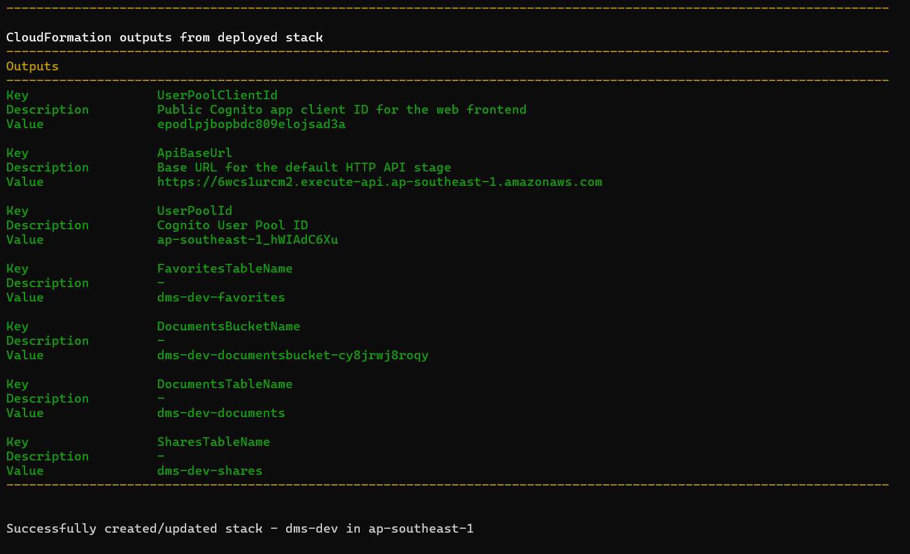
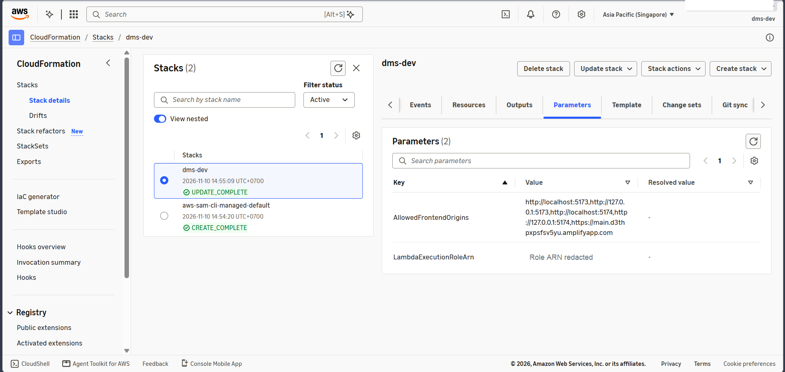

{}
Trang này ghi nhận cấu hình đã triển khai và kết quả đã quan sát; hành vi chưa xác minh được nêu rõ.
{}

## Mục tiêu

Triển khai frontend và xác minh xác thực cùng API call thật.

## Các bước thực hiện

1. Cấu hình Region công khai, Cognito ID và API base URL. Không thêm secret access key vào biến frontend.
2. Cập nhật Cognito callback/sign-out URL và CORS S3/API với domain Amplify chính xác khi cần.
3. Chạy deployment và xem build log đến khi trạng thái thành công.
4. Mở URL HTTPS được cấp, kiểm thử đăng nhập và một thao tác tài liệu cần bảo vệ, sau đó refresh route lồng nhau.

## Minh chứng triển khai và xác minh

Parameter `AllowedFrontendOrigins` của stack đang triển khai có origin Amplify production và các origin Vite local. Lambda execution role ARN đã được che trong ảnh báo cáo.

Ảnh kiểm tra API health được ghi ở mục 5.7.2. Đăng nhập, liệt kê tài liệu, upload/download và các thao tác tài liệu đã được thực hiện trên ứng dụng đã deploy; xem mục 5.8.2, 5.10.1 và 5.10.2. Không chụp thêm ảnh tổng hợp riêng vì các luồng này đã có minh chứng ở những mục đó.

## Kết quả mong đợi

Ứng dụng truy cập được qua HTTPS và hoàn thành luồng backend đã kiểm chứng.

## Khắc phục sự cố

- Build thành công không đảm bảo API kết nối; kiểm tra Network và CORS.
- Callback URL phải khớp chính xác origin triển khai.
