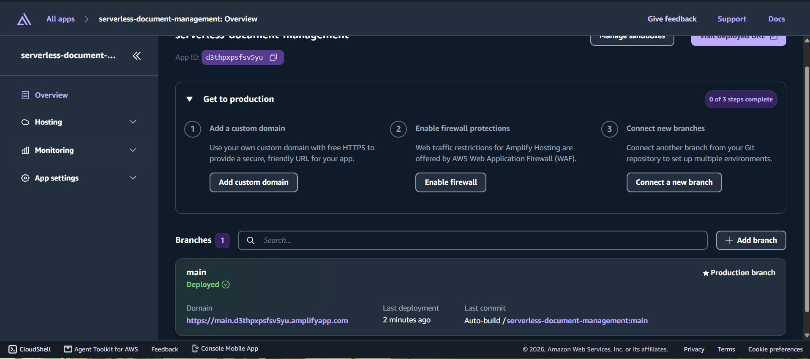

{}
Trang này ghi nhận cấu hình đã triển khai và kết quả đã quan sát; hành vi chưa xác minh được nêu rõ.
{}

## Mục tiêu

Triển khai frontend và xác minh xác thực cùng API call thật.

## Các bước thực hiện

Hoàn thành từng bước theo thứ tự. Đọc thao tác, phần giải thích và kết quả cần xác nhận trước khi chuyển sang bước kế tiếp.

### Bước 1: Điền biến môi trường cho branch Amplify

Trong Amplify Console, mở app → **Hosting → Environment variables**. Thêm năm biến `VITE_*` theo bảng ở mục 5.1.3 hoặc 5.8.1, dùng Outputs của đúng stack. Không thêm secret access key. Lưu cấu hình để Amplify chạy deployment mới.

### Bước 2: Cập nhật CORS với domain mới

Sau khi branch build xong, mở URL HTTPS của branch và sao chép origin, ví dụ `https://main.xxxxx.amplifyapp.com` (không có dấu `/` cuối). Từ PowerShell ở thư mục `backend`, chạy lại lệnh `sam deploy` ở mục 5.1.3 với cùng stack name, Region, profile và role. Trong `AllowedFrontendOrigins`, giữ các origin local còn dùng và thêm origin Amplify mới. Xem change set, xác nhận đúng stack rồi chờ `UPDATE_COMPLETE`. Frontend dùng Cognito User Pools API trực tiếp nên không cần managed-login callback URL.

### Bước 3: Chờ build frontend hoàn tất

Trong Amplify → branch, mở build mới nhất và chờ trạng thái thành công. Nếu build lỗi, kiểm tra build command `npm ci && npm run build`, artifact directory `dist` và các biến `VITE_*`. Xác nhận đã cấu hình SPA rewrite ở mục 5.9.1 để refresh route không trả 404.

### Bước 4: Kiểm tra ứng dụng đã deploy

Mở domain HTTPS production, đăng ký hoặc đăng nhập Cognito, rồi tải Kho tài liệu. Mở Developer Tools → **Network** và xác nhận request API đã đăng nhập trả `200`. Thử upload/download file nhỏ hơn 20 MiB. API URL, Pool ID, Client ID và bucket phải cùng lấy từ một stack; CORS API và S3 phải khớp chính xác origin Amplify.

## Minh chứng triển khai và xác minh

Parameter `AllowedFrontendOrigins` của stack đang triển khai có origin Amplify production và các origin Vite local. Lambda execution role ARN đã được che trong ảnh báo cáo.

Ảnh kiểm tra API health được ghi ở mục 5.7.2. Đăng nhập, liệt kê tài liệu, upload/download và các thao tác tài liệu đã được thực hiện trên ứng dụng đã deploy; xem mục 5.8.2, 5.10.1 và 5.10.2. Không chụp thêm ảnh tổng hợp riêng vì các luồng này đã có minh chứng ở những mục đó.

## Kết quả mong đợi

Ứng dụng truy cập được qua HTTPS và hoàn thành luồng backend đã kiểm chứng.

## Khắc phục sự cố

- Build thành công không đảm bảo API kết nối; kiểm tra Network và CORS.
- Callback URL phải khớp chính xác origin triển khai.
